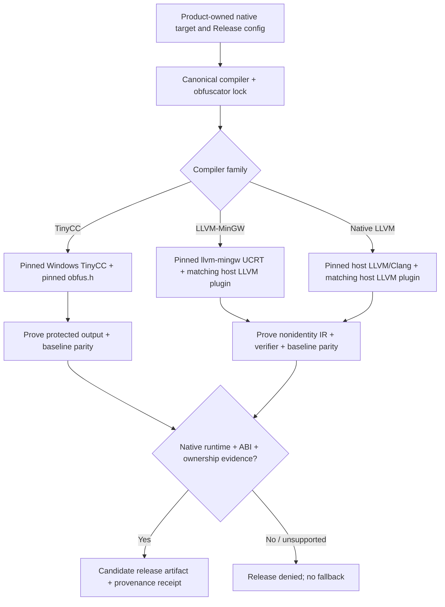

# Release compiler / obfuscation profiles (Draft)

Canonical tracking: [vcpkg-cache #243](https://github.com/qigao/vcpkg-cache/issues/243).

**Status: design + fail-closed selector only. No release profiles are qualified, no compiler setup action is published, and no downstream product has been switched.** An accepted contract does not prove that any particular executable was obfuscated.

## Scope and ownership

Use one canonical `vcpkg-cache` compiler/obfuscator lock for first-party native Release, MinSizeRel and RelWithDebInfo artifacts. The downstream product owns its manifest, sources, protected targets, application tests, signing, and final release. Keep generic third-party vcpkg dependencies **unmodified** by the obfuscation process. A library or executable that the product marks as a protected release target must be compiled with a supported backend and must pass its own actual-code qualification; otherwise block release, **never** produce a silent unprotected Release.

Debug remains baseline/unobfuscated unless a product intentionally requests a separate diagnostic configuration. Baseline comparison builds and sanitizer CI must continue to run. Obfuscation raises the difficulty of reverse engineering; it does not replace cryptography, code signing, access controls, or safe resource ownership.

The machine-readable candidate catalog is [compiler-contracts/release-obfuscation.json](../compiler-contracts/release-obfuscation.json). The policy selector [scripts/ci/validate_release_obfuscation.py](../scripts/ci/validate_release_obfuscation.py) denies all pending Release profiles. A product must eventually run this check as part of its release admission and **independently verify real compile receipts/IR, native execution, binary hashes and ABI evidence**.

## Release backend matrix

| Compiler | Obfuscator | Target | Current decision |
|---|---|---|---|
| [TinyCC-builder](https://github.com/DosX-dev/TinyCC-builder) | [obfus.h](https://github.com/DosX-dev/obfus.h) | Windows x86/x64, C | Candidate; tests and integration pending |
| TinyCC-builder | obfus.h | Windows ARM64 | **Denied**: upstream obfus.h documents x86/x64 only |
| [LLVM-MinGW](https://github.com/mstorsjo/llvm-mingw) | [obfuscator-llvm](https://github.com/eshard/obfuscator-llvm) | Windows x86/x64/ARM64, UCRT | Candidate; per-host/target compiler/plugin/native tests pending |
| Upstream LLVM/Clang | obfuscator-llvm | Native Linux x64/ARM64, macOS x64/ARM64 | Candidate; pin native distribution and qualify plugin |
| SDK-provided Clang | obfuscator-llvm | Android, iOS | **Denied until separately qualified** |

Windows 32-bit LLVM-MinGW remains a viable future target, but is not assumed admitted just because its compiler emits 32-bit COFF. For TinyCC Windows ARM64, changing the **whole product's chosen compiler** to an independently qualified llvm-mingw ARM64 profile is allowed; silent substitution of a TinyCC object/library or compiler in the same build is forbidden.

### Immutable candidate inputs (checked 2026-10-30)

- TinyCC-builder **2026-10-29** standard Windows package, tag commit `3631e1bac2984508c7f0d81681c3f2d444b38205`; exact ZIP SHA256 is in the JSON catalog. Do not select `latest` or UPX. The upstream release bundle includes `obfh-update.cmd`, but **does not bundle an immutable obfus.h**. Never execute the updater during a pinned release.
- obfus.h header from commit `71159dfd61ffed463bb3d8942670420bc1940f12`. Fetch this source by exact commit and verify the retrieved header digest in the eventual tool archive.
- llvm-mingw **20261020**, annotated tag resolving to `e08a31fbfe5cfdad07b698299af22d66e5608383`, built against `llvmorg-23.1.4`. Windows, Linux and macOS **host** archive SHA256 values are in the catalog. The host ZIP/tar and the Windows target CPU are separate dimensions.
- eshard/obfuscator-llvm at `ad26aa21b90cc5c5118d32114b674d1455f54168`, containing LLVM 23-oriented changes. This is **not** evidence that it loads inside the distributed llvm-mingw 23.1.4 compiler on any given host.
- Native Linux/macOS LLVM `llvmorg-23.1.4` is a **candidate version only**; no immutable native archive/distribution is pinned yet.

Do not upgrade a source or compiler without changing the lock and qualifying the affected host/target lanes. Keep the compiler bundle lock distinct from `VCPKG_CACHE_REVISION`; do not invalidate unrelated dependency ABIs just because a product protection seed changed.

## Architecture



A plugin is a **host** shared library loaded by Clang, not a target DLL injected into the resulting executable. Different host OSes require different plugin artifacts even when the target Windows ABI is identical.

## LLVM release compilation

The LLVM version, C++ ABI, build configuration, LLVM shared-library configuration and plugin ABI must match the actual compiler **that loads the plugin**. Building a plugin against a similarly numbered system `llvm-config` is insufficient without a real load/run test against the selected Clang. The existing [qigao/tcc Draft #1](https://github.com/qigao/tcc/pull/1) LLVM 14 pass test is prior evidence for the test method only, not llvm-mingw 23 conformance.

Example **test command shape**, after exact plugin installation:

```sh
export LLVM_OBF_SCALAROPTIMIZERLATE_PASSES="flattening,substitution"
export LLVM_OBF_SEED="0xA04252B187478C00A40BC6D81D1A8A52"
"$CLANG" -O2 -fpass-plugin="$LLVM_OBF_PLUGIN" -c protected.c -o protected.o
```

This command alone is **not** sufficient for a release. Acceptance must show the plugin actually loaded, the requested nonempty pass pipeline ran, LLVM IR changed in expected ways, `opt` verified valid IR, and native baseline/obfuscated applications behaved identically over a meaningful input matrix. Preserve external symbols, calling conventions, error paths, concurrency, cancellation, ownership and runtime cleanup. Evaluate LTO/ThinLTO and `-O0` separately; do not assume optimizer extension points run in every mode. Do not insert a placeholder pass or treat an unchanged IR as successful obfuscation.

For Windows, `VCPKG_CHAINLOAD_TOOLCHAIN_FILE` / exact triplets must configure the **same actual llvm-mingw** when producing vcpkg libraries and compiling the consumer. Cache ABI must include target architecture, CRT/UCRT, compiler identity, features, and relevant flags. Never reuse the MSVC v145 `qigao-x64-windows-v145` binary cache as if it were LLVM-MinGW.

For Linux/macOS native builds, use a separately pinned upstream LLVM/Clang distribution. macOS AppleClang is not assumed binary-compatible with upstream LLVM pass plugins. For Android NDK and iOS/Xcode, match the actual SDK/NDK Clang first, then qualify host plugin loading, device/app execution, platform signing/hardening and artifact provenance. If the platform tooling forbids or lacks this support, the protected Release lane remains blocked until it has a validated implementation.

## TinyCC / obfus.h release compilation

`obfus.h` is an invasive **C source header** and must be included **after standard and system headers**, before the source code being protected. Injecting it globally ahead of all SDK headers, or pretending that linker flags alone activate it, is incorrect. An actual protected module may contain:

```c
#include <stdint.h>
#include <stdio.h>
/* Other required system and platform headers must come first. */
#define OBFH_SEED 123456789u
#define OBFH_DISABLE_ANTIDEBUG 1
#define OBFH_FAKE_SIGNATURES 0
#include "obfus.h"

/* Protected C function bodies follow the include. */
```

Record a reproducible per-build unsigned 32-bit seed, and separately verify **at least two seeds** retain the same observable behavior. Check evidence of generated-code transformation for representative source, real x86/x64 Windows runs, DLL lifecycle, ABI/layout/ownership. Reject `OBFH_DISABLE_ANY_OBFUSCATION=1`. Do not enable fake packer signatures or intrusive anti-debug in routine CI or a release without product-specific approval and compatibility testing.

TinyCC and llvm-mingw/Clang objects must not be assumed link-compatible. Where a TinyCC C module and LLVM C++/WTL app interact, qualify a versioned fixed-width exported C DLL interface with bounded ownership and no cross-CRT allocation/deallocation.

## Test and release admission

Use a single PR concurrency group with `cancel-in-progress: true` and compiler/build caching; do not spawn redundant older runner jobs. Every new profile needs:

1. Exact immutable source and archive locks, extracted securely (no traversal, duplicate/colliding paths, or unverified binaries), and an actual `--version`/compiler identity check.
2. Host-target correctness: native compiler execution on the host, target COFF/ELF/Mach-O architecture and runtime/CRT proof.
3. **Real obfuscation evidence**: for LLVM, plugin load, pass activation, nonidentity/valid IR and behavioral parity; for TinyCC, protected-header inclusion, two-seed transformed output and parity.
4. Native release consumer test and stable C/C++ ABI/ownership/cancel/cleanup tests; tests must run in a real target environment, not merely cross-compile.
5. Exact CI HEAD, tool/plugin/source digests, compiler+obfuscator flags, non-secret build seed, dependency ABI, resulting binary SHA256, and signed/package release receipt reviewed by the product owner.
6. Negative regression tests for absent/mismatched plugin/header, wrong LLVM major, missing evidence, unsupported target, disabled protection and source-build fallback.

The current validator proves only internal catalog consistency and **fails every Release selection because all candidates are pending**. It does not install a compiler, compile protected code, audit binaries, or authorize release. Those are follow-up implementation/CI gates tracked by issue #243.

Example current commands:

```sh
python3 scripts/ci/validate_release_obfuscation.py --validate-only
# Correctly denied until the real llvm-mingw/obfuscator-llvm acceptance passes:
python3 scripts/ci/validate_release_obfuscation.py \
  --build-type Release --compiler llvm-mingw \
  --host linux-x64 --target windows-arm64
# Baseline verification remains valid:
python3 scripts/ci/validate_release_obfuscation.py --build-type Debug
```

Do not mark a profile qualified based only on these Python tests. No downstream release compiler default changes are authorized by this design.
