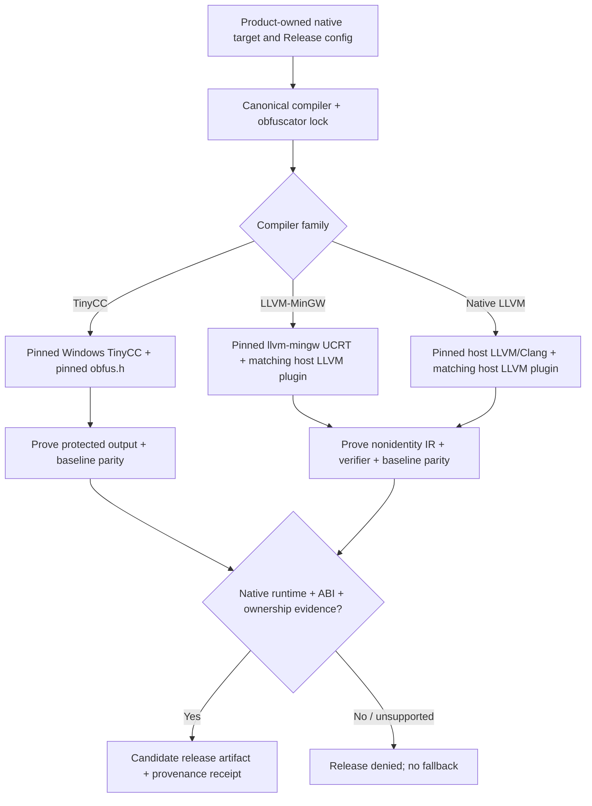

# Release compiler / obfuscation profiles (Draft)

Canonical tracking: [vcpkg-cache #243](https://github.com/qigao/vcpkg-cache/issues/243).

**Status (2026-10-30): all supported first-party Windows/Linux/macOS protected Release artifacts require upstream LLVM/Clang + eshard/obfuscator-llvm; Windows uses llvm-mingw/UCRT, Linux/macOS use separately pinned native LLVM. GCC is a test-only compiler; MSVC/AppleClang may remain diagnostic compilers but cannot produce protected Release. All profiles remain pending until exact host plugin, compiler archives and native app evidence qualify. No downstream Release has been switched or published.**

## Scope and ownership

Use one canonical `vcpkg-cache` compiler/obfuscator lock for first-party native Release, MinSizeRel and RelWithDebInfo artifacts. The downstream product owns its manifest, sources, protected targets, application tests, signing, and final release. Keep generic third-party vcpkg dependencies **unmodified** by the obfuscation process. A library or executable that the product marks as a protected release target must be compiled with a supported backend and must pass its own actual-code qualification; otherwise block release, **never** produce a silent unprotected Release.

Debug remains baseline/unobfuscated unless a product intentionally requests a separate diagnostic configuration. Baseline comparison builds and sanitizer CI must continue to run. Obfuscation raises the difficulty of reverse engineering; it does not replace cryptography, code signing, access controls, or safe resource ownership.

The machine-readable candidate catalog is [compiler-contracts/release-obfuscation.json](../compiler-contracts/release-obfuscation.json). The policy selector [scripts/ci/validate_release_obfuscation.py](../scripts/ci/validate_release_obfuscation.py) denies all pending Release profiles. A product must eventually run this check as part of its release admission and **independently verify real compile receipts/IR, native execution, binary hashes and ABI evidence**.

## Release backend matrix

| Compiler | Obfuscator | Target | Current decision |
|---|---|---|---|
| [TinyCC-builder](https://github.com/DosX-dev/TinyCC-builder) | [obfus.h](https://github.com/DosX-dev/obfus.h) | Windows x86/x64, C | Separate experimental profile, not the default protected Release |
| TinyCC-builder | obfus.h | Windows ARM64 | **Denied**: upstream obfus.h documents x86/x64 only |
| [LLVM-MinGW](https://github.com/mstorsjo/llvm-mingw) | [obfuscator-llvm](https://github.com/eshard/obfuscator-llvm) | Windows x64/ARM64, UCRT | Selected Release compiler; host plugin and native product acceptance pending |
| Upstream LLVM/Clang | obfuscator-llvm | Native Linux x64/ARM64, macOS x64/ARM64 | Required Release compiler; exact distribution, plugin and native tests pending |
| SDK-provided Clang | obfuscator-llvm | Android, iOS | **Denied until separately qualified** |

Windows 32-bit LLVM-MinGW remains a viable future target, but is not assumed admitted just because its compiler emits 32-bit COFF. For TinyCC Windows ARM64, changing the **whole product's chosen compiler** to an independently qualified llvm-mingw ARM64 profile is allowed; silent substitution of a TinyCC object/library or compiler in the same build is forbidden.

### Immutable candidate inputs (checked 2026-10-30)

- TinyCC-builder **2026-10-29** standard Windows package, tag commit `3631e1bac2984508c7f0d81681c3f2d444b38205`; exact ZIP SHA256 is in the JSON catalog. Do not select `latest` or UPX. The upstream release bundle includes `obfh-update.cmd`, but **does not bundle an immutable obfus.h**. Never execute the updater during a pinned release.
- obfus.h header from commit `71159dfd61ffed463bb3d8942670420bc1940f12`. Fetch this source by exact commit and verify the retrieved header digest in the eventual tool archive.
- llvm-mingw **20261020**, annotated tag resolving to `e08a31fbfe5cfdad07b698299af22d66e5608383`, built against `llvmorg-23.1.4`. Windows, Linux and macOS **host** archive SHA256 values are in the catalog. The host ZIP/tar and the Windows target CPU are separate dimensions.
- eshard/obfuscator-llvm at `ad26aa21b90cc5c5118d32114b674d1455f54168`, containing LLVM 23-oriented changes. This is **not** evidence that it loads inside the distributed llvm-mingw 23.1.4 compiler on any given host.
- The official LLVM `llvmorg-23.1.4` **annotated tag resolves to source commit** `7a941dfb2877a0b8cf30323fefa85ad019e0b0f5`. Its release assets and SHA256 digests are now immutable-locked for Linux x64, Linux ARM64 and macOS ARM64 in the catalog (compressed archives ~2.02GB / 1.83GB / 1.57GB). No matching official macOS x64 asset was found: this lane remains blocked until a separately pinned source-built or released native x64 distribution is qualified. The plugin binaries are still independently unpinned.

Do not upgrade a source or compiler without changing the lock and qualifying the affected host/target lanes. Keep the compiler bundle lock distinct from `VCPKG_CACHE_REVISION`; do not invalidate unrelated dependency ABIs just because a product protection seed changed.

## Architecture



A plugin is a **host** shared library loaded by Clang, not a target DLL injected into the resulting executable. Different host OSes require different plugin artifacts even when the target Windows ABI is identical.

## LLVM release compilation

The LLVM version, C++ ABI, build configuration, LLVM shared-library configuration and plugin ABI must match the actual compiler **that loads the plugin**. Building a plugin against a similarly numbered system `llvm-config` is insufficient without a real load/run test against the selected Clang. The existing [qigao/tcc Draft #1](https://github.com/qigao/tcc/pull/1) LLVM 14 pass test is prior evidence for the test method only, not llvm-mingw 23 conformance.

Example **test command shape**, after exact plugin installation:

```sh
export LLVM_OBF_SCALAROPTIMIZERLATE_PASSES="flattening,substitution"
export LLVM_OBF_SEED="0xA04252B187478C00A40BC6D81D1A8A52"
"$CLANG" -O2 -fpass-plugin="$LLVM_OBF_PLUGIN" -c protected.c -o protected.o
```

This command alone is **not** sufficient for a release. Acceptance must show the plugin actually loaded, the requested nonempty pass pipeline ran, LLVM IR changed in expected ways, `opt` verified valid IR, and native baseline/obfuscated applications behaved identically over a meaningful input matrix. Preserve external symbols, calling conventions, error paths, concurrency, cancellation, ownership and runtime cleanup. Evaluate LTO/ThinLTO and `-O0` separately; do not assume optimizer extension points run in every mode. Do not insert a placeholder pass or treat an unchanged IR as successful obfuscation.

For Windows, `VCPKG_CHAINLOAD_TOOLCHAIN_FILE` / exact triplets must configure the **same actual llvm-mingw** when producing vcpkg libraries and compiling the consumer. Cache ABI must include target architecture, CRT/UCRT, compiler identity, features, and relevant flags. Never reuse the MSVC v145 `qigao-x64-windows-v145` binary cache as if it were LLVM-MinGW.

For Linux/macOS native Release builds, use the selected, immutable upstream LLVM/Clang distribution. macOS AppleClang is not assumed binary-compatible with upstream LLVM pass plugins. For Android NDK and iOS/Xcode, match the actual SDK/NDK Clang first, then qualify host plugin loading, device/app execution, platform signing/hardening and artifact provenance. If the platform tooling forbids or lacks this support, the protected Release lane remains blocked until it has a validated implementation.

## Windows protected Release: llvm-mingw replaces MSVC

The **Release compiler** for Windows x64/ARM64 first-party protected targets is pinned
\`llvm-mingw 20261020\` (LLVM **23.1.4**, **UCRT**) with an exact host-built
\`eshard/obfuscator-llvm\` plugin. MSVC may remain in Debug/diagnostic jobs but
its Release CI cannot publish, sign or upload the protected Windows artifact.
Keep non-obfuscated Debug and sanitizer behavior as a baseline; do not delete
useful Windows OS ABI tests just because they run on Microsoft-hosted runners.

The existing \`.github/actions/setup-llvm-mingw/action.yml\` now accepts
\`build-type: Release\`, \`MinSizeRel\`, or \`RelWithDebInfo\` only when
\`plugin-path\` identifies an **already installed host plugin** whose basename,
SHA256, source commit and LLVM 23.1.4 version exactly match
\`sources.obfuscator-llvm.host_plugin_assets\`. A Windows x64 plugin is used
by Windows x64 *host Clang* when compiling either x64 or ARM64 **targets**;
it is not an ARM64 target DLL and does not execute in the released app.

**Currently the host plugin asset lock is empty.** Therefore a protected
Release request fails **before downloading llvm-mingw**, until the selected
upstream LLVM 23.1.4 host plugin is actually built, its artifact and SHA256
are pinned, and its provenance is reviewed. No arbitrary system LLVM,
Microsoft clang-cl, MSVC or TinyCC substitution is allowed.

After a pinned plugin is available, the action calls
\`scripts/ci/verify_llvm_mingw_obfuscation.py\` against the **real selected
clang**, with a nontrivial C11 source held in this script (not an
installer/consumer project). It requires:
- LLVM plugin digest and real compiler identity, with fixed recorded
  \`LLVM_OBF_SEED\`.
- \`flattening\` **and** \`substitution\` independently change the
  protected function's IR, as does the combined pipeline.
- Clang compiles the transformed IR to COFF and produces nonidentical,
  machine-correct x64/AA64 PE artifacts.
- On a matching native host, baseline and protected PE executions have
  exactly the same output and exit successfully.
- A machine-readable receipt includes compiler/plugin/source/binary hashes;
  the action exposes \`obfuscator-verified\` and
  \`obfuscator-compile-flag\` but deliberately keeps
  \`release-qualified=false\`. **The product's target-native acceptance,
  tests, ABI, CFG/SEH, ownership, signing and package receipt remain required.**

Downstream usage after the immutable plugin is supplied:
\`\`\`yaml
- uses: qigao/vcpkg-cache/.github/actions/setup-llvm-mingw@EXACT_REVIEWED_COMMIT
  id: llvm
  with:
    target: arm64
    build-type: Release
    plugin-path: ${{ steps.verified_plugin.outputs.absolute_path }}
\`\`\`

\`verified_plugin\` above is an *illustrative prerequisite*, **not an
existing action**. It must itself obtain a locked host artifact, not a
floating binary. Bind the action's \`toolchain-file\` output to the actual
Windows GNU/UCRT CMake/vcpkg triplet, and apply its
\`obfuscator-compile-flag\` **per first-party protected target**, rather than
globally to third-party/vcpkg dependency compiles. Never reuse MSVC v145
binary caches as if their CRT, ABI, libraries or link format were identical.

The release job should build both Windows x64 and ARM64 with llvm-mingw,
run x64 natively, then run the **same hash-verified ARM64 PE** on actual
Windows ARM64. Native ABI, exceptions, CFG and application workflow remain
independent. Cross compilation alone is not ARM64 Release acceptance.
Compiler setup and the compiler-plugin preflight are never a substitute
for a complete product Release gate.

## Linux and macOS protected Release: native LLVM only

The machine-readable `native_protected_release` policy selects **upstream
LLVM/Clang 23.1.4 + obfuscator-llvm** for the four native targets
`linux-x64`, `linux-arm64`, `macos-x64`, and `macos-arm64`.
GCC/G++ are retained strictly as **test, diagnostic and differential**
compilers, never as the Release compiler for protected first-party targets.
AppleClang likewise cannot silently replace the upstream LLVM plugin host.
Android/iOS toolchains remain separate until genuine NDK/Xcode plugin and
device acceptance is available; ARM64 support alone does not qualify them.

A *single* existing installer owner,
`scripts/setup-compiler-toolchain.py`, now accepts `llvm-native` and
performs SHA256-verified source archive extraction, immutable version
verification, native Clang and Clang++ selection, a generated Linux/Darwin
CMake toolchain file, real ELF64/Mach-O64 CPU checks, and **native runtime
execution**. Its `compiler-contracts/release-obfuscation.json` source lock
is now `distribution=pinned` with exactly three official, SHA256-locked
host archives for Linux x64, Linux ARM64 and macOS ARM64. macOS x64 has
no matching official release asset in the reviewed tag and must remain RED
until an immutable x64 build and full native evidence are obtained. The
next real gates are exact host plugin builds and LLVM/compiler runtime ABI.
**Do not substitute an installed distro clang or AppleClang.**

`.github/actions/setup-llvm-native/action.yml` is the reusable native
equivalent of the Windows llvm-mingw action. On protected Release it requires
both an **exact SHA256-locked native compiler archive** and an **exact
SHA256-locked host obfuscator**. It fails **before downloading** an unpinned
compiler. After successful setup, the existing single LLVM obfuscation
preflight compiles the protected C11 function, requires real individual
`flattening` and `substitution` IR changes, validates ELF or Mach-O
machine and checks **native baseline/protected runtime parity**. No release
eligibility is granted by action setup or this small compiler preflight.

Illustrative downstream usage **after the exact native archives and host
plugins have been qualified**:

```yaml
- id: llvm
  uses: qigao/vcpkg-cache/.github/actions/setup-llvm-native@EXACT_REVIEWED_COMMIT
  with:
    target: arm64
    build-type: Release
    plugin-path: ${{ steps.verified_plugin.outputs.absolute_path }}
```

The plugin step in the example is a prerequisite supplied by the product
workflow, not an existing generic plugin downloader. The product selects the
same compiler's CMake toolchain for its Release targets, applies the action
`obfuscator-compile-flag` only to explicitly protected first-party
sources, and runs complete target-native SDK/app/ABI tests before publish.
Third-party dependencies must not silently switch compiler, CRT or C++ ABI.
On Linux qualify glibc/musl and libc++/libstdc++ separately; on macOS the
Apple SDK, linker, deployment target and signing/notarization remain
required even though **AppleClang is not the Release compiler**.

**Gate:** `Release`, `MinSizeRel` and `RelWithDebInfo` select pinned
LLVM + obfuscator-llvm and fail closed when absent. GCC and AppleClang
can still participate in Debug, sanitizers, source parity and performance
comparisons. Keep a single CI concurrency group with cancellation and
compiler caching, without new installer/consumer fixture projects or
duplicate CI workflows.

## Exact LLVM host obfuscator plugin source-build candidate

A **single optional Linux x64 native host-plugin candidate** is implemented
within the existing `validate-compiler-setup-actions.yml` workflow.
It runs on PR synchronization only while the PR description contains
`[host-plugin-candidate]`, or on an explicit workflow dispatch, to avoid
re-downloading the approximately 2 GB official LLVM archive on unrelated
commits. The job reuses `setup-llvm-native`, CMake/Ninja/ccache and the
existing preflight, without creating separate installer/consumer projects.

`scripts/ci/build_llvm_obfuscator_candidate.py` obtains exact pinned
`eshard/obfuscator-llvm` source through a detached Git SHA checkout,
compiles the real host shared library against the **verified LLVM 23.1.4
distribution's** `llvm-config --cmakedir`, and records compiler, source,
plugin and build-tool hashes. The freshly generated candidate manifest
is accepted by the preflight only in an explicit **candidate-only** mode
that requires matching host/target native execution and does not modify
the canonical Release lock. This closes the first-run bootstrap problem:
the binary cannot have a reviewed SHA256 *before* it has been built.
It must never be used as a trusted production plugin until its exact
artifact digest and ABI/host receipt are reviewed and pinned.

Success requires each requested pass to produce nonidentity function IR
independently, combined transformed IR to compile to native object code,
a real native ELF executable with matching architecture, and identical
baseline/protected application outputs. Any compiler/plugin mismatch,
unmodified IR, unverified CPU, corrupt source or missing native runtime
fails the candidate CI. The upload is a short-retention GitHub Actions
artifact, **not** a product distribution or permission to publish.
Windows x64/ARM64 and macOS host plugins remain independent targets
that require their own compiler/plugin identity and native acceptance.

## TinyCC / obfus.h release compilation

`obfus.h` is an invasive **C source header** and must be included **after standard and system headers**, before the source code being protected. Injecting it globally ahead of all SDK headers, or pretending that linker flags alone activate it, is incorrect. An actual protected module may contain:

```c
#include <stdint.h>
#include <stdio.h>
/* Other required system and platform headers must come first. */
#define OBFH_SEED 123456789u
#define OBFH_DISABLE_ANTIDEBUG 1
#define OBFH_FAKE_SIGNATURES 0
#include "obfus.h"

/* Protected C function bodies follow the include. */
```

Record a reproducible per-build unsigned 32-bit seed, and separately verify **at least two seeds** retain the same observable behavior. Check evidence of generated-code transformation for representative source, real x86/x64 Windows runs, DLL lifecycle, ABI/layout/ownership. Reject `OBFH_DISABLE_ANY_OBFUSCATION=1`. Do not enable fake packer signatures or intrusive anti-debug in routine CI or a release without product-specific approval and compatibility testing.

TinyCC and llvm-mingw/Clang objects must not be assumed link-compatible. Where a TinyCC C module and LLVM C++/WTL app interact, qualify a versioned fixed-width exported C DLL interface with bounded ownership and no cross-CRT allocation/deallocation.

## Test and release admission

Use a single PR concurrency group with `cancel-in-progress: true` and compiler/build caching; do not spawn redundant older runner jobs. Every new profile needs:

1. Exact immutable source and archive locks, extracted securely (no traversal, duplicate/colliding paths, or unverified binaries), and an actual `--version`/compiler identity check.
2. Host-target correctness: native compiler execution on the host, target COFF/ELF/Mach-O architecture and runtime/CRT proof.
3. **Real obfuscation evidence**: for LLVM, plugin load, pass activation, nonidentity/valid IR and behavioral parity; for TinyCC, protected-header inclusion, two-seed transformed output and parity.
4. Native release consumer test and stable C/C++ ABI/ownership/cancel/cleanup tests; tests must run in a real target environment, not merely cross-compile.
5. Exact CI HEAD, tool/plugin/source digests, compiler+obfuscator flags, non-secret build seed, dependency ABI, resulting binary SHA256, and signed/package release receipt reviewed by the product owner.
6. Negative regression tests for absent/mismatched plugin/header, wrong LLVM major, missing evidence, unsupported target, disabled protection and source-build fallback.

The current validator proves only internal catalog consistency and **fails every Release selection because all candidates are pending**. It does not install a compiler, compile protected code, audit binaries, or authorize release. Those are follow-up implementation/CI gates tracked by issue #243.

Example current commands:

```sh
python3 scripts/ci/validate_release_obfuscation.py --validate-only
# Correctly denied until the real llvm-mingw/obfuscator-llvm acceptance passes:
python3 scripts/ci/validate_release_obfuscation.py \
  --build-type Release --compiler llvm-mingw \
  --host linux-x64 --target windows-arm64
# Baseline verification remains valid:
python3 scripts/ci/validate_release_obfuscation.py --build-type Debug
```

Do not mark a profile qualified based only on these Python tests. No downstream release compiler default changes are authorized by this design.
